# rotki en diagrammes

Vue pédagogique de l'architecture de rotki, destinée aux lecteurs non spécialistes.
Chaque diagramme montre **un plan différent** du même système. Les couleurs, les formes et les
traits ont la même signification d'un diagramme à l'autre (voir la légende ci-dessous).

Documents de référence détaillés : `architecture_overview.md` (architecture technique) et
`subsystems_evaluation.md` (évaluation des sous-systèmes).

---

## Légende

Lisez cette légende avant les diagrammes. Chaque couleur indique **dans quel langage ou dans quelle
couche** se trouve un élément. Chaque forme indique **son rôle**.

```mermaid
flowchart LR
    subgraph LEG ["Légende"]
        direction LR
        L1["Interface utilisateur<br/>(frontend, TypeScript / Vue)"]:::front
        L2["Logique métier<br/>(backend, Python)"]:::back
        L3["Service de performance ou de supervision<br/>(Rust)"]:::rust
        L4[("Données stockées sur le disque")]:::data
        L5{{"Service externe<br/>(blockchain, exchange, prix)"}}:::ext
        L6(["Personne"]):::user
        L7["Problème de conception<br/>(trait pointillé)"]:::back
    end
    L1 ~~~ L2 ~~~ L3 ~~~ L4 ~~~ L5 ~~~ L6 ~~~ L7

    classDef front fill:#dbeafe,stroke:#1d4ed8,color:#0f172a,stroke-width:2px
    classDef back fill:#dcfce7,stroke:#15803d,color:#0f172a,stroke-width:2px
    classDef rust fill:#ffedd5,stroke:#c2410c,color:#0f172a,stroke-width:2px
    classDef data fill:#f3e8ff,stroke:#7e22ce,color:#0f172a,stroke-width:2px
    classDef ext fill:#f1f5f9,stroke:#64748b,color:#0f172a,stroke-dasharray:4 3
    classDef user fill:#fef9c3,stroke:#a16207,color:#0f172a,stroke-width:2px
```

| Élément | Couleur | Forme | Signification |
|---------|---------|-------|---------------|
| Interface | bleu | rectangle | ce que l'utilisateur voit et manipule (écrit en TypeScript / Vue) |
| Logique métier | vert | rectangle | le « cerveau » de rotki (écrit en Python) |
| Performance / supervision | orange | rectangle | composants écrits en Rust |
| Données | violet | cylindre | informations stockées (bases de données) |
| Externe | gris | hexagone pointillé | services que rotki interroge mais ne contrôle pas |
| Utilisateur | jaune | pilule | la personne qui utilise rotki |
| Trait plein | — | flèche | « appelle » ou « envoie des données à » |
| Trait pointillé | — | flèche | dépendance **inattendue** (à corriger, voir plan 4) |

---

## Plan 1 : rotki en une image

Ce qu'est rotki, avec les acteurs principaux.

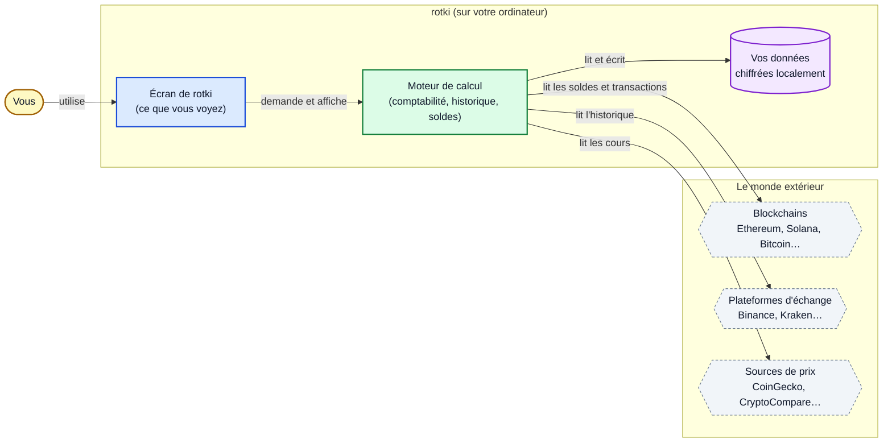

**À retenir** : rotki *lit* les informations de vos comptes et de la blockchain, puis calcule vos gains,
pertes et impôts localement. Vos données personnelles restent sur votre machine : rotki ne les envoie
pas à un serveur central, même s'il interroge les services ci-dessus.

---

## Plan 2 : quels langages, qui parle à qui

Chaque couleur est un langage ou une couche. Les flèches sont des modes de communication.

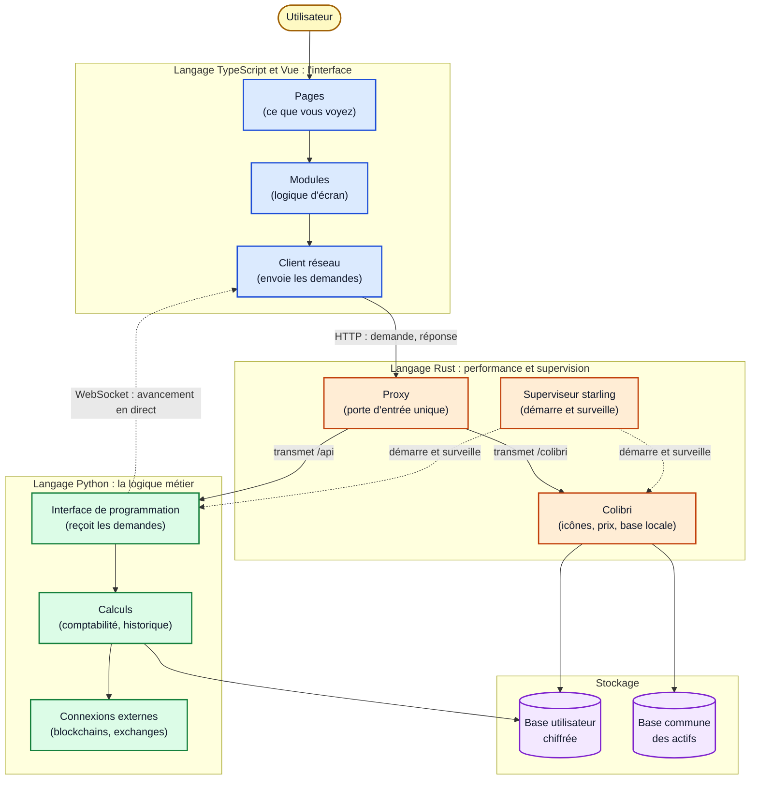

**Lecture** : le bleu est tout ce qui s'affiche, le vert tout ce qui calcule, l'orange tout ce qui
démarre, protège ou accélère. Les flèches en pointillé sont des liens de surveillance ou de mise à jour
en direct, pas des demandes ponctuelles.

---

## Plan 3 : ce qui démarre quand vous ouvrez rotki

Quatre programmes collaborent. Le superviseur les lance dans le bon ordre et les arrête proprement.

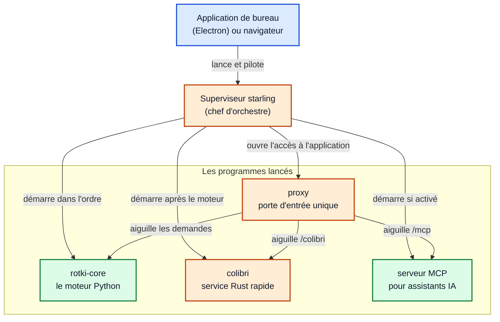

**À retenir** : le superviseur évite qu'un programme reste allumé après la fermeture de l'application
et empêche d'ouvrir deux fois les mêmes données.

---

## Plan 4 : ensembles et sous-ensembles du moteur Python

Chaque grand bloc du moteur. Les flèches montrent qui utilise qui. Les **flèches pointillées marquées ⚠**
sont des dépendances à l'envers : une couche basse (calcul, base de données) dépend de l'interface
HTTP, ce qui n'est pas souhaité.

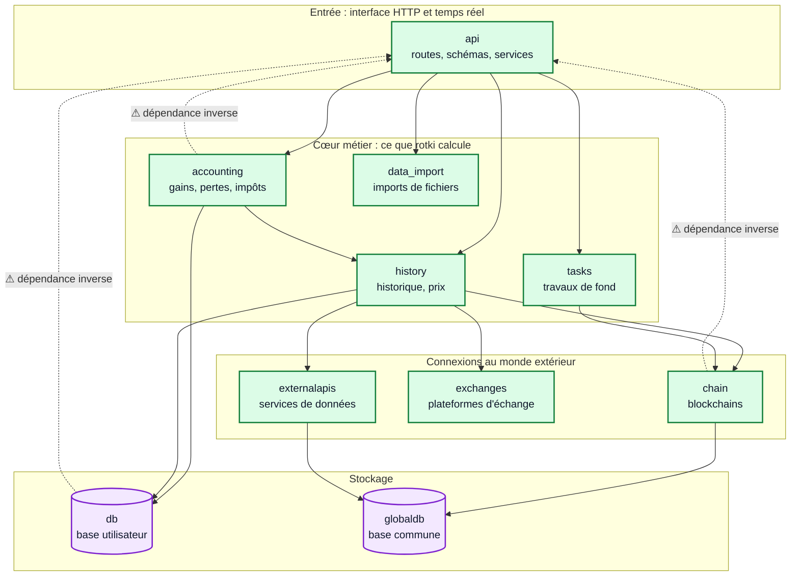

**Lecture** : on devrait pouvoir descendre seulement de haut en bas (de l'entrée vers le stockage).
Les trois flèches pointillées marquées ⚠ remontent vers l'entrée : c'est le principal point d'attention
technique identifié.

---

## Plan 5 : les blockchains, en poupées russes

Un ensemble contient des sous-ensembles. Les chaînes qui fonctionnent comme Ethereum partagent
la même logique de base (la « couche EVM »).

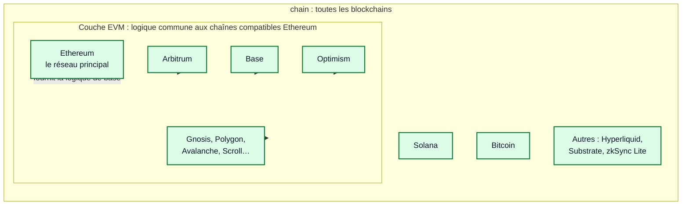

**Lecture** : ajouter une chaîne compatible Ethereum revient surtout à la brancher sur la couche EVM
commune. Solana et Bitcoin ont leur propre logique.

---

## Plan 6 : l'interface en sous-ensembles

La partie visible, du plus général (pages) au plus technique (socle commun).

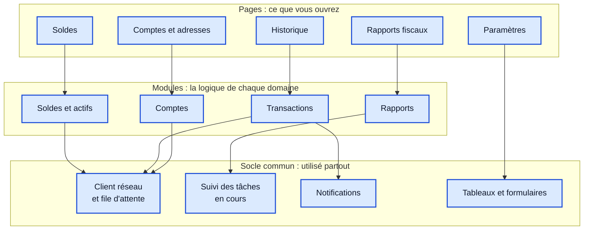

**Lecture** : une page ne contient pas la logique : elle s'appuie sur un module, qui s'appuie sur le socle
commun. Les pages sont donc faciles à ajouter ou à modifier.

---

## Plan 7 : parcours d'une action (afficher ses soldes)

Ce qui se passe, étape par étape, quand vous ouvrez la page des soldes.

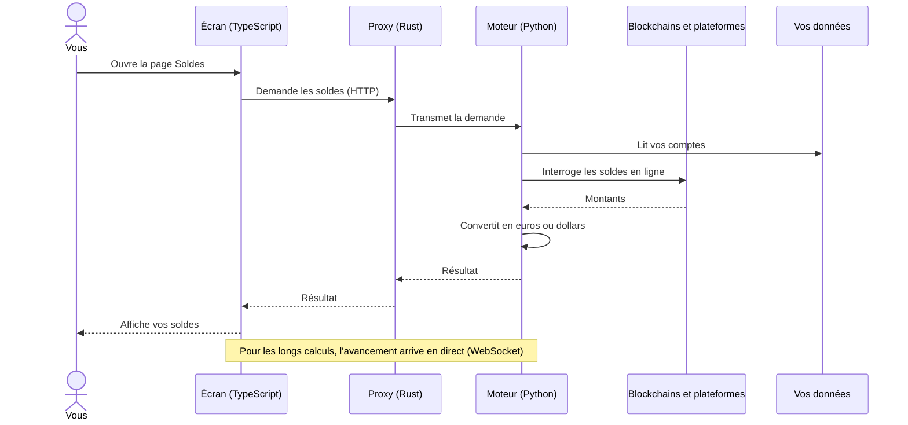

---

## Plan 8 : sécurité simplifiée (la session)

Comment rotki sait que c'est bien vous, sans envoyer votre mot de passe à chaque action.

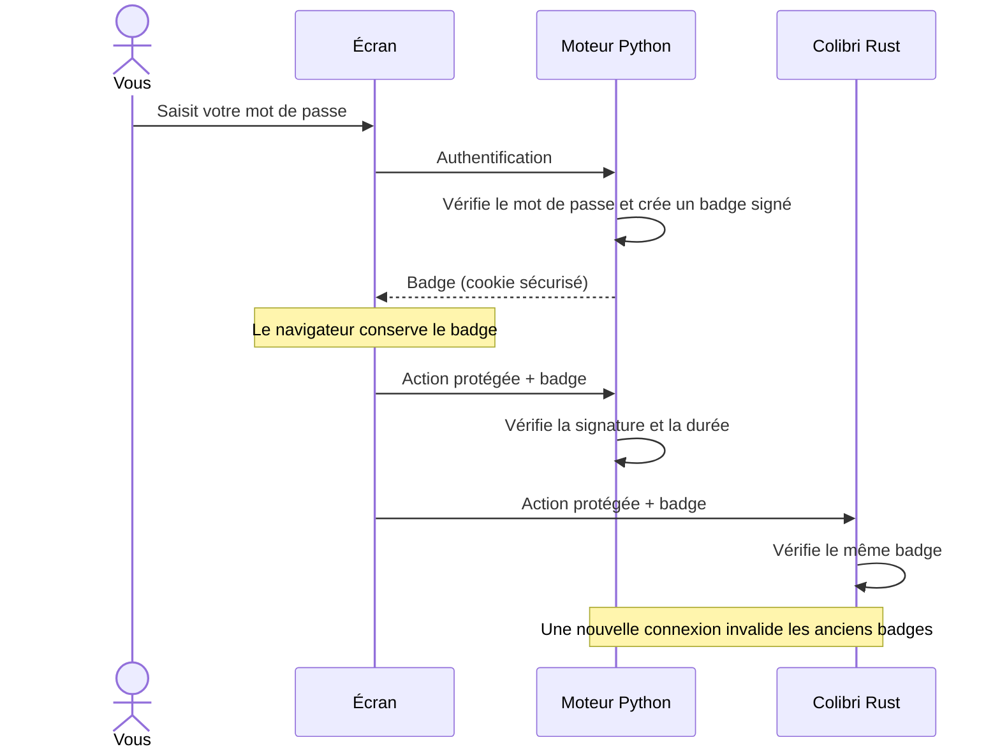

**Pourquoi deux vérifications ?** Le moteur et Colibri sont tous deux accessibles sur votre machine.
Chacun vérifie le badge, sans dépendre de l'autre.

---

## Plan 9 : état de santé des sous-systèmes

Évaluation qualitative issue de `subsystems_evaluation.md`. Vert : solide. Orange : à surveiller.
Rouge : dette prioritaire. La taille indique le volume de code de production.

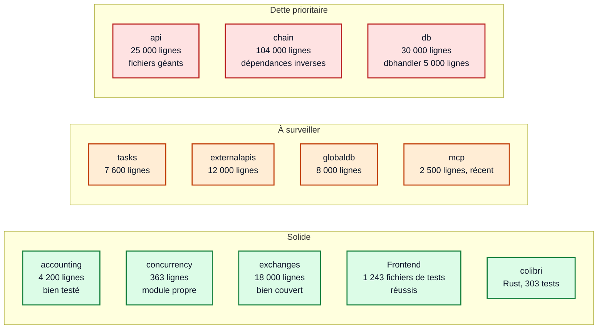

**Limite** : les tests Python et Rust n'ont pas pu être exécutés dans cette session. Leur état
est donc « non vérifié », et non « bon » ni « mauvais ».

---

## Plan 10 : quelle est la part de chaque langage ?

Volume de code de production et de tests, en lignes.

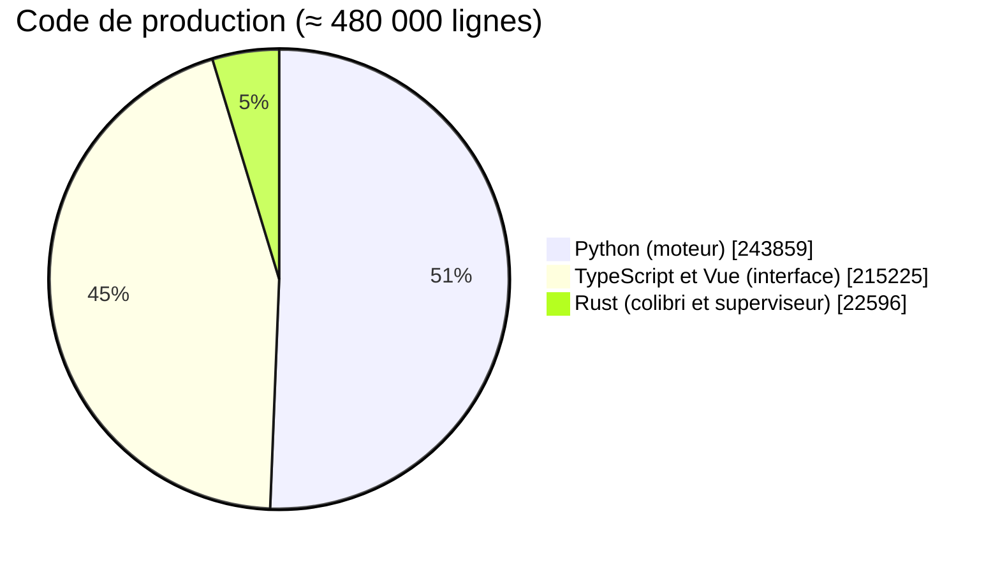

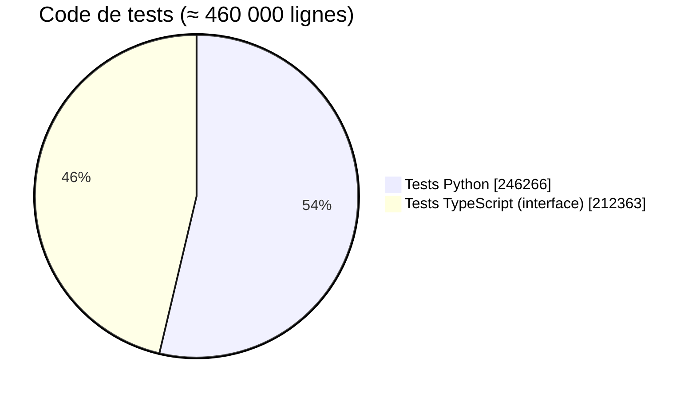

**Lecture** : rotki est autant une application d'interface qu'un moteur de calcul. Presque la moitié du code
est consacrée aux tests, ce qui est un bon signe de sérieux.

---

## Plan 11 : priorités de travail

Chaque action recommandée, selon son impact estimé et son effort. Positions indicatives, fondées sur
le jugement de l'évaluation.

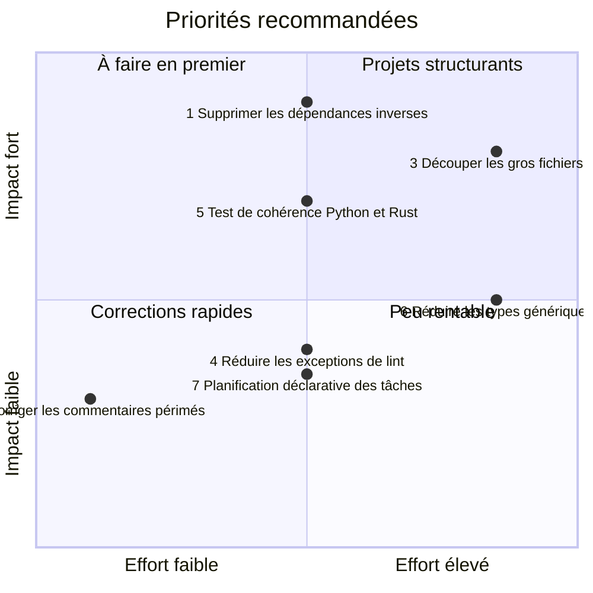

---

## Plan 12 : ce que rotki permet de faire

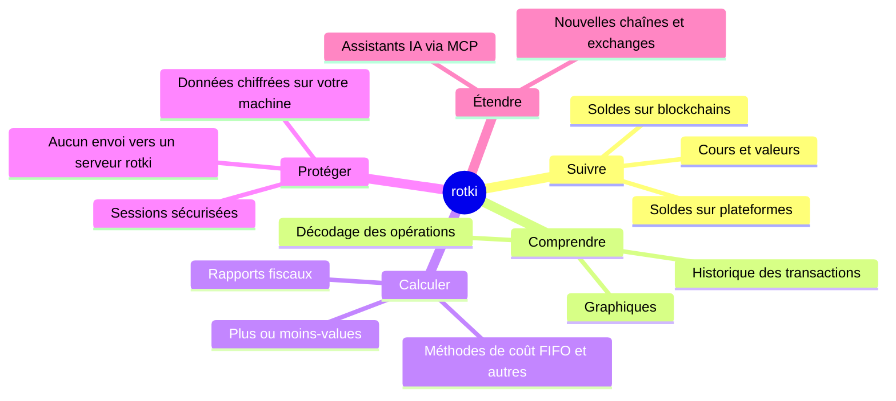

---

## Glossaire rapide

| Terme | Explication simple |
|-------|--------------------|
| Blockchain | registre public des transactions (Ethereum, Bitcoin…) |
| Exchange | plateforme où l'on achète et vend des cryptos (Binance, Kraken…) |
| Frontend | la partie visible de l'application |
| Backend | la partie qui calcule, cachée derrière l'écran |
| API | la « porte » par laquelle l'écran demande des informations au moteur |
| WebSocket | canal qui envoie des nouvelles en direct (avancement d'un calcul) |
| Cookie de session | petit badge signé qui prouve que vous êtes connecté |
| Base chiffrée | fichier de données protégé par votre mot de passe |
| MCP | protocole permettant à un assistant IA d'utiliser rotki |
| Dépendance inverse | un composant bas qui dépend d'un composant haut (à éviter) |
